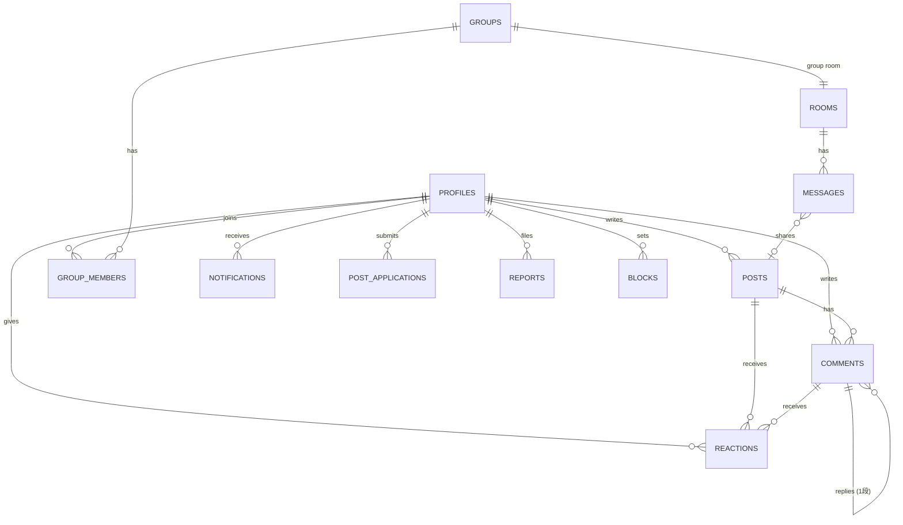

# データの持ち主と権限

<!-- バックエンドがあるときだけ使う。画面を作る前に決める。 -->

最終更新：2026-11-03　承認：未

## 考え方
- 中心は **配信（post）とコメント（comment）**。グループ・チャット・個人の投稿は、ここにつながる形で持つ
- オーナーの配信と個人の投稿は同じ `posts` に入れ、`kind` で分ける（議論の仕組みを1つで済ませるため）
- 権限の正はサーバー（Supabase の RLS）。アプリ側に同じ判定を書かない

## 主体（誰が何を持つか）
| 主体 | 何を持つか | 何に属するか |
| --- | --- | --- |
| 人（profiles） | 表示名、職種（任意）、言語、役割（member / poster / owner）、通知の設定 | − |
| 配信・投稿（posts） | 日英の見出しと本文、元情報のリンク、配信枠（7:00 / 11:30 / 15:30 / 22:00 / 速報）、公開日時 | 書いた人（owner または poster） |
| コメント（comments） | 本文、返信先（1段まで） | post と書いた人 |
| リアクション（reactions） | 種類 | post またはコメントと押した人 |
| グループ（groups） | 名前、招待コード | 作った人 |
| グループのメンバー（group_members） | 役割（作成者 / メンバー） | group と人 |
| チャットルーム（rooms） | 種類（group / dm） | group、または2人 |
| メッセージ（messages） | 本文、共有した post（任意） | room と送った人 |
| 通知（notifications） | 種類、対象、既読 | 受け取る人 |
| 投稿の申請（post_applications） | 理由、職種、状態（申請中 / 承認 / 却下） | 申請した人 |
| 通報（reports） | 対象、理由、状態 | 通報した人 |
| ブロック（blocks） | ブロックした相手 | ブロックした人 |
| 端末（push_tokens） | プッシュ通知の宛先 | 人 |
| 配信の材料（materials） | 公式データの数字、見出しとリンク、取得日時 | サーバー（定時処理） |

## ER 図

## 権限（誰が読めて、誰が書けるか）
| データ | 読める人 | 作れる人 | 変えられる人 | 消せる人 | 有料のみ |
| --- | --- | --- | --- | --- | :-: |
| 配信（オーナー） | 誰でも（未ログイン含む） | owner | owner | owner | |
| 個人の投稿 | 誰でも（未ログイン含む） | poster（認証済み）・owner | 書いた人 | 書いた人・owner（非表示） | |
| コメント | 誰でも（未ログイン含む）。ブロックした相手のものは表示しない | ログインした人（1分あたりの回数に上限） | 書いた人（5分以内） | 書いた人・owner（非表示） | |
| リアクション | 誰でも（数だけ） | ログインした人 | − | 押した人 | |
| グループ | メンバーだけ | ログインした人 | 作成者 | 作成者 | |
| グループのメンバー | メンバーだけ | 招待コードを持つ人（自分を追加） | − | 本人（退出）・作成者 | |
| メッセージ | そのルームのメンバーだけ | そのルームのメンバー。dm は同じグループにいる相手とだけ、ブロックし合っていないとき | 書いた人（5分以内） | 書いた人・owner（通報時の非表示） | |
| 通知 | 本人 | サーバー | 本人（既読） | 本人 | |
| 投稿の申請 | 本人・owner | ログインした人（申請中は1件まで） | owner（承認・却下） | − | |
| 通報 | owner | ログインした人 | owner | − | |
| ブロック | 本人 | 本人 | − | 本人 | |
| 配信の材料 | owner | サーバー | − | サーバー（古いものを自動で削除） | |

- 権限の正はサーバー（RLS）。アプリ側に同じ判定を書かない（書くなら表示のためだけ）
- 役割（member / poster / owner）は本人が変えられない。owner だけが poster に上げられる
- 「非表示」は消さずに印を付ける（通報への対応の記録を残すため）。返信が付いたコメントを本人が消したときは「削除されたコメント」と表示し、返信は残す

## 保存とオフライン
- 端末に残すもの：開いた配信と議論の最新の内容、チャットの直近のメッセージ、送れなかったコメントとメッセージ
- 保存に失敗したとき：**端末に残して再送**。失敗した書き込みには「再送」を出す
- 競合したとき：後勝ち（自分の書き込みの編集だけなので、ぶつかることは少ない）

## リアルタイム
- 開いている配信のコメント、開いているチャットルームのメッセージだけを、リアルタイムで受け取る
- 一覧（home・chats）は開いたときと、下に引いたときに読み込む（同時接続の上限を節約するため。無料プランは同時 200）

## データの出入り口
- 画面は `src/lib/data/` だけを通す。サーバーを直接さわらない
- 環境変数がないときはデモデータを同じ入口から返す（デモモード）
- デモデータは本番と同じ形で作る（日英の配信、議論、グループ、通知）

## ファイルの保存場所
| フォルダ | 公開／非公開 | 中身 |
| --- | --- | --- |
| （MVP ではなし） | − | 画像の投稿・アバター画像は「あとで」 |

## バックアップ
- 開発中（無料プラン）：自動バックアップがないため、毎日データを書き出す定時処理を置く
- 公開後（Pro）：毎日の自動バックアップ（7日分）

## マイグレーションの運用
- 置き場所：`supabase/migrations/`（日付順）
- 確認用 SQL：`supabase/checks/`
- 本番に流す人と手順：オーナーが手で流す
