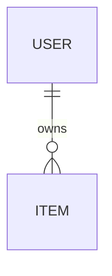

# データの持ち主と権限

<!-- バックエンドがあるときだけ使う。画面を作る前に決める。
     Pawroom では「ペットがアカウントを持つ」から「人と家族が持つ」への作り直しが最大の手戻りだった。 -->

最終更新：{日付}　承認：{未／済}

## 主体（誰が何を持つか）
| 主体 | 何を持つか | 何に属するか |
| --- | --- | --- |
| 人（user） | {} | − |
| {} | {} | {} |

## ER 図

## 権限（誰が読めて、誰が書けるか）
| データ | 読める人 | 作れる人 | 変えられる人 | 消せる人 | 有料のみ |
| --- | --- | --- | --- | --- | :-: |
| {} | {} | {} | {} | {} | |

- 権限の正はサーバー（RLS）。アプリ側に同じ判定を書かない（書くなら表示のためだけ）。

## 保存とオフライン
- 端末に残すもの：{}
- 保存に失敗したとき：{端末に残して再送 ／ 知らせて元に戻す}
- 競合したとき：{後勝ち ／ …}

## データの出入り口
- 画面は `src/lib/data/` だけを通す。サーバーを直接さわらない
- 環境変数がないときはデモデータを同じ入口から返す（デモモード）
- デモデータは本番と同じ形で作る

## ファイルの保存場所
| フォルダ | 公開／非公開 | 中身 |
| --- | --- | --- |
| {} | {} | {} |

## マイグレーションの運用
- 置き場所：`supabase/migrations/`（日付順）
- 確認用 SQL：`supabase/checks/`
- 本番に流す人と手順：{オーナーが手で流す}
