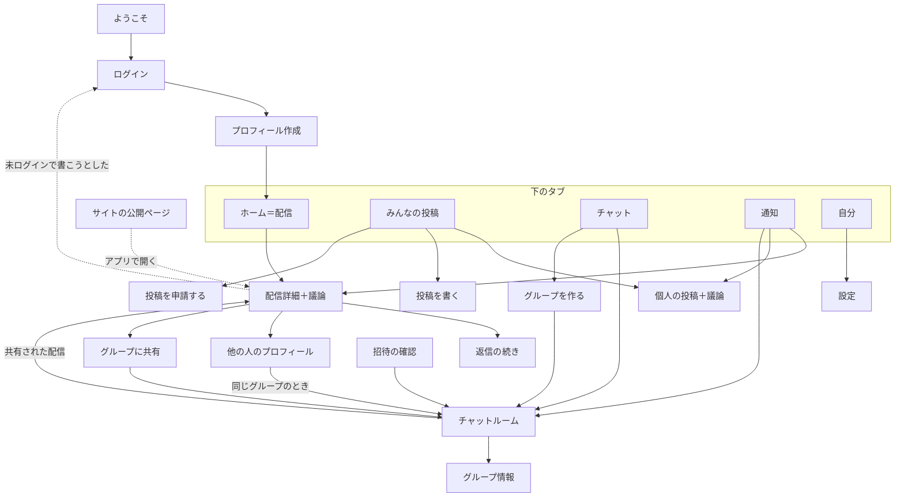

# 画面・遷移・操作

<!-- MVP の画面はすべてここに載せる。載っていない画面は作らない。押せない UI は残さない。 -->

最終更新：2026-11-03　承認：済（2026-11-03）

## 考え方
- **主役は「配信詳細」**。オーナーの配信が上にあり、そのすぐ下でみんなが議論する。どの画面からも、最後はここに戻ってくる
- ホームは「いま、どの配信で議論が起きているか」が分かる入口
- グループ・個人間チャット・個人の投稿は、配信の議論を深めるための脇役
- スマホ（幅 320〜440）を基準に作る。Web も同じ画面をスマホ幅で中央に表示する

## 画面一覧
| ID | 画面 | 役割（主役は1つ） | 開き方 | 戻り先 | MVP |
| --- | --- | --- | --- | --- | :-: |
| welcome | ようこそ | 何の場所かを一言で伝え、ログインへ | 初回起動 | − | ○ |
| login | ログイン | Apple / Google / メールでログイン | welcome、未ログインでコメントしようとしたとき | 元の画面 | ○ |
| profile-setup | プロフィール作成 | 表示名・職種（任意）・言語を決める | 初回ログイン後 | home | ○ |
| home | ホーム（配信） | オーナーの配信の一覧。各配信の議論の盛り上がり（コメント数・新着）が見える | タブ1 | − | ○ |
| post | **配信詳細＋議論** | **配信の本文と、その下の議論。下に入力欄が常にある** | home・通知・共有リンク・グループ内の共有 | 開いた元 | ○ |
| thread | 返信の続き | 深い返信の枝だけを広い幅で読む（字下げ4段を超えたとき） | post の「続きを読む」 | post | ○ |
| community | みんなの投稿 | 認証された人の投稿の一覧 | タブ2 | − | ○ |
| user-post | 個人の投稿の詳細＋議論 | post と同じ形（投稿者が個人なだけ） | community・通知 | 開いた元 | ○ |
| compose-post | 投稿を書く | テキスト＋リンクで投稿（認証済みの人だけ） | community の「投稿する」 | community | ○ |
| apply-post | 投稿を申請する | 投稿したい理由と職種を書いて申請 | community の「投稿を申請する」（未認証の人） | community | ○ |
| chats | チャット | グループと個人間チャットを**一緒に**新しい順で並べる。上のボタン「すべて / 個人 / グループ」で表示を切り替え。右下にグループを作るボタン | タブ3 | − | ○ |
| room | チャットルーム | グループ・個人間の会話。共有された配信はカードで表示し、タップで post へ | chats・通知・招待リンク | chats | ○ |
| group-info | グループ情報 | メンバー、招待リンク、退出 | room の右上 | room | ○ |
| group-new | グループを作る | 名前・アイコン（写真フォルダから、またはサンプルのアイコンから。単色はなし）・誘う人を選んで作り、招待リンクを出す | chats の右下の丸いボタン | room | ○ |
| invite | 招待の確認 | 招待リンクから開いたとき、参加するかを確認 | 招待リンク（ディープリンク） | room | ○ |
| share-sheet | 配信をグループに共有 | どのグループに送るか選ぶ | post の「グループで話す」 | post | ○ |
| search | 検索 | 何も入れていないとき：最近さがしたもの・いま話題になっていること（議論が多い順）・ジャンル・話してみたい人。入れたとき：記事・動画・人・グループ・コメントをまとめて出し、種類ごとに切り替え。見つからないときは言い換えの例を出す | 下のタブ横の丸いボタン・ライブラリ右上 | 開いた元 | ○ |
| notifications | お知らせ | 返信・反応・メンション・配信・速報・グループの招待と新着。「すべて / 返信・反応 / 配信 / グループ」で絞り込み、今日・昨日・今週で区切る。未読に印、「すべて既読にする」。右上の歯車で、配信の時刻ごと・種類ごとにオンオフ | ホーム右上のベル | 開いた元 | ○ |
| me | 自分のプロフィール | メンバーカード（記事の表紙1の形）、ひとこと、数字（コメント・もらった▲・グループ）、自分のコメント・保存した記事・グループ。保存した記事は長方形のサムネを2列で並べ、下に題名。並び替え（保存した順・配信が新しい順・みんなの声が多い順）。右上の歯車で設定。**タップしたアイコンの位置から広がって出てくる** | ホーム左上のアイコン | 開いた元 | ○ |
| settings | 設定 | プロフィールの編集／**アカウント**：ログイン方法・投稿の申請／**お知らせ**：種類・夜は鳴らさない時間／**プライバシーと安全**：1対1を受け取る相手・ミュートした言葉・職種を出すか・ブロックした人・通報の窓口／**表示**：言語・コメントの並び順・時刻の表示／**そのほか**：規約・プライバシーポリシー・投稿のルール・問い合わせ／ログアウト・アカウントの削除（「削除」と入力して確認） | 自分のプロフィールの歯車 | me | ○ |
| person | 他の人のプロフィール | 同じ形のメンバーカード、ひとこと、最近のコメントと投稿。同じグループなら「メッセージを送る」 | コメントの名前・グループのメンバーをタップ | 開いた元 | ○ |
| report | 通報 | 理由を選んで送る | コメント・投稿・メッセージ・人の長押しメニュー | 開いた元 | ○ |
| admin-compose | 【オーナー】配信を作る | 集まった材料（データの数字・見出しとリンク）を見ながら、日英の本文を書いて出す | Web の管理画面 | admin | ○ |
| admin-apply | 【オーナー】投稿の申請 | 申請を読んで認める・断る | Web の管理画面 | admin | ○ |
| admin-reports | 【オーナー】通報 | 通報を見て、非表示・停止・問題なしを決める | Web の管理画面 | admin | ○ |
| web-post | 【サイト】配信の公開ページ | 誰でも読める配信と議論。書くにはログイン | 検索・SNS からのリンク | − | ○ |
| events | イベント | − | − | − | あとで |

## 遷移図

## 操作の割り当て
<!-- 同じ指の動きが同じ画面でぶつからないこと。iOS の「左端から右へスワイプで戻る」とぶつかる横スワイプは使わない。 -->
| 画面 | タップ | 長押し | スワイプ | ピンチ | その他 |
| --- | --- | --- | --- | --- | --- |
| home / community | カードで詳細へ | − | 下に引いて更新 | − | − |
| post / user-post | 返信・リアクション・名前でプロフィール・リンクで元記事（外部ブラウザ）・並び順の切り替え | コメントのメニュー（返信・コピー・通報・ブロック・自分のなら削除） | 下に引いて更新 | − | 入力欄は画面下に固定 |
| room | 共有カードで post へ | メッセージのメニュー（返信・コピー・通報・自分のなら削除） | − | − | 上にスクロールで過去を読み込む |
| chats | ルームへ | − | 下に引いて更新 | − | − |
| notifications | 該当の場所へ（コメントならその位置までスクロール） | − | 下に引いて更新 | − | 開いたら既読 |

## 議論の形（2026-11-03 オーナーが決定）
1. **日本語と英語は1つの議論に混ぜる**。翻訳は「あとで」
2. **コメントの並び順は「反応が多い順」が初期設定**。YouTube のように、議論の上の切り替えで「反応が多い順 / 新しい順」を選べる。選んだ順は設定に保存し、次に開いたときも使う
   - 「反応が多い順」は、リアクションと返信の数に、新しさを加えて並べる（具体的な計算はフェーズ5で少人数で試して調整）
   - 新しいコメントが埋もれないよう、自分が書いたばかりのコメントは自分の画面では一番上に出し、前回から増えたコメント数を「新しいコメント 3件」と表示する
3. **返信は何段でも入れ子にできる**。スマホで横幅がなくならないよう、字下げは画面上は4段まで。それより深い返信は「続きを読む」で返信の続きの画面（thread）を開き、その枝だけを広い幅で表示する
4. **ログインしていない人も議論を読める**。書く・リアクションするときだけログインを求め、ログイン後は元の場所に戻る
5. グループを抜けたあとの個人間チャット：過去のやり取りは読めるが、新しく送れない

## まだ動かない操作の扱い
- MVP の外の機能（イベントなど）は、ボタン自体を出さない。`src/constants/features.ts` の切り替えで隠す

## 空・読み込み中・エラーの状態
| 画面 | 空のとき | 読み込み中 | 失敗したとき |
| --- | --- | --- | --- |
| home | 「次の配信は 11:30」と次の時刻を出す | カードの形の枠 | 前回の内容を表示し、上に「更新できませんでした」 |
| post | 「最初のコメントを書く」と入力欄を強調 | 本文を先に出し、議論は枠 | 本文は前回の内容。送れなかったコメントは端末に残し「再送」 |
| community | 「まだ投稿はありません」＋申請への案内 | カードの形の枠 | 前回の内容を表示 |
| chats | 「グループを作るか、招待リンクで参加」 | 行の形の枠 | 前回の内容を表示 |
| room | 「最初のメッセージを送る」 | 吹き出しの形の枠 | 送れなかったメッセージに「再送」 |
| notifications | 「返信やリアクションがここに届きます」 | 行の形の枠 | 前回の内容を表示 |

## 速報の対象（案）
配信はオーナーが出すため、「速報」は**材料がそろったらオーナーに知らせる**仕組みにする。目標：発表から5分以内にオーナーへ通知。

| 区分 | 対象 |
| --- | --- |
| 中央銀行 | FRB（FOMC）、日銀、ECB、イングランド銀行の政策金利の発表 |
| 米国の指標 | 雇用統計、CPI（消費者物価指数）、GDP 速報 |
| 日本の指標 | 全国 CPI、日銀短観、GDP 速報 |
| 欧州の指標 | ユーロ圏 CPI 速報 |
| そのほか | オーナーが手動で出す（大きな市場の動き、地政学のニュースなど） |

- 株価指数の値（日経平均、S&P 500 など）を自動で取り込んで表示するには、データの利用許諾が必要なことが多い（未確認）。MVP では公式統計の数字だけを自動で集め、株価はオーナーが本文に書く
