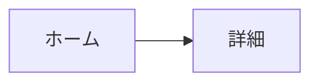

# 画面・遷移・操作

<!-- MVP の画面はすべてここに載せる。載っていない画面は作らない。押せない UI は残さない。 -->

最終更新：{日付}　承認：{未／済}

## 画面一覧
| ID | 画面 | 役割（主役は1つ） | 開き方 | 戻り先 | MVP |
| --- | --- | --- | --- | --- | :-: |
| home | ホーム | {} | タブ | − | ○ |
| {} | {} | {} | {タブ／push／モーダル／ディープリンク} | {} | {○／あとで} |

## 遷移図

## 操作の割り当て
<!-- 同じ指の動きが同じ画面でぶつからないこと。 -->
| 画面 | タップ | 長押し | スワイプ | ピンチ | その他 |
| --- | --- | --- | --- | --- | --- |
| {} | {} | {} | {} | {} | {} |

## まだ動かない操作の扱い
- {例：見た目は残し、押すと「Coming soon」と表示・読み上げ}

## 空・読み込み中・エラーの状態
| 画面 | 空のとき | 読み込み中 | 失敗したとき |
| --- | --- | --- | --- |
| {} | {} | {} | {} |
